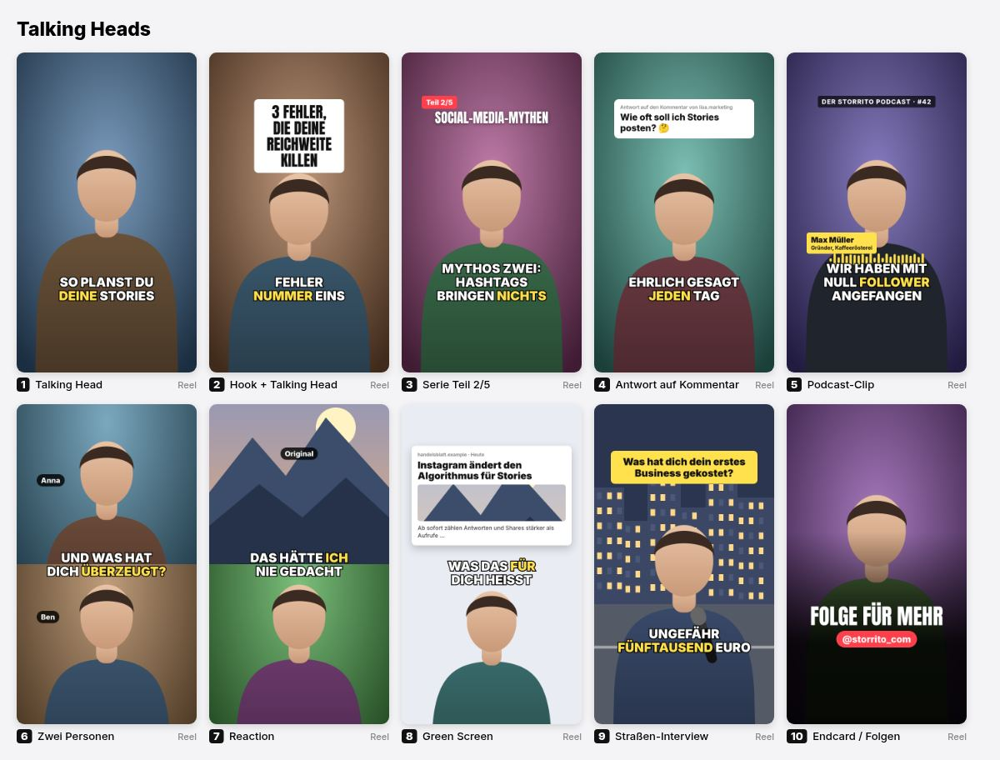
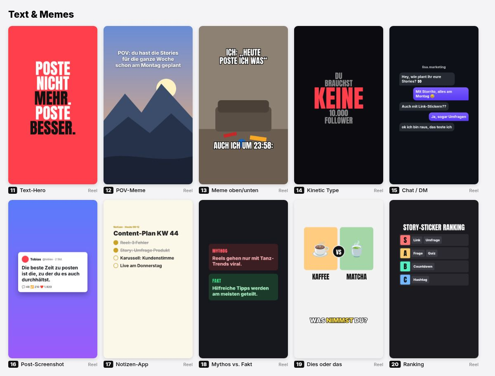
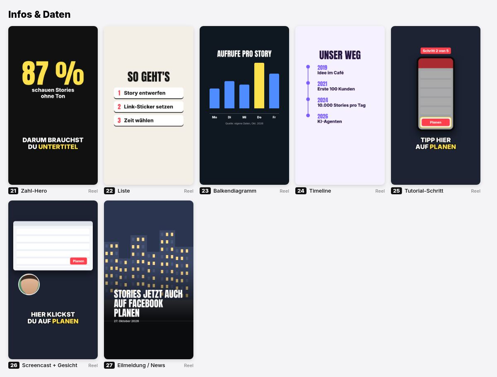
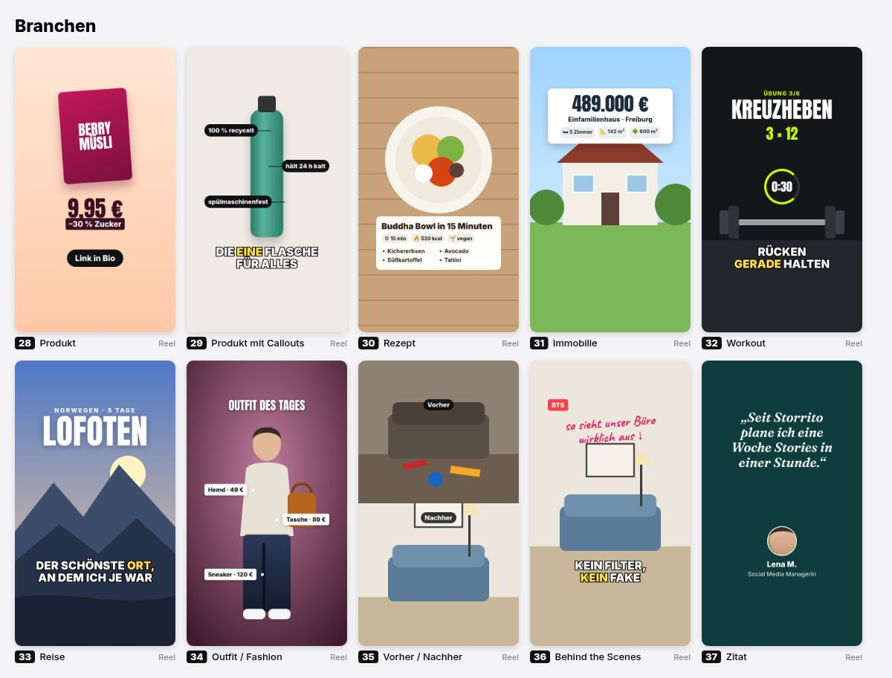
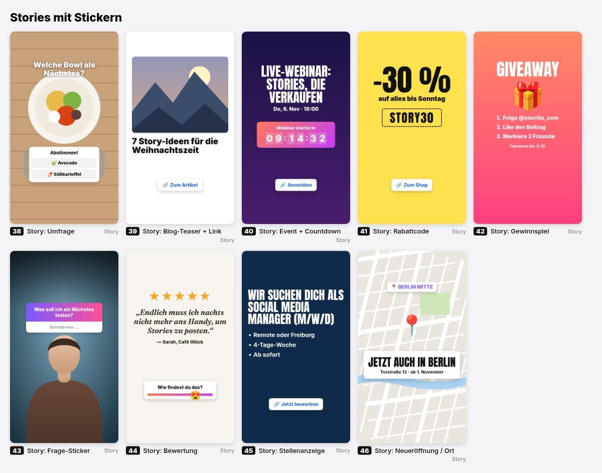
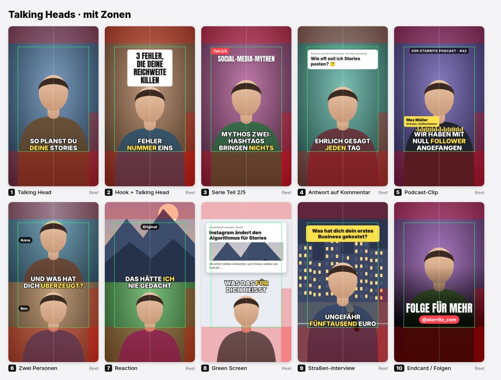

# platform-zones

Where the platforms lay their buttons, names and captions over a video, per frame, as one table that every skill of this collection asks instead of keeping numbers of its own: the box that stays clear for text, faces and the thing being shown; what each app covers; where a feed or a profile grid shows the video cut to another ratio. When nobody said where the video goes, the usual platforms of its frame together.

It is an agent of its own (upload a frame, see what Reels covers, see [SKILL.md](SKILL.md)) and the zones step of the other agents: captions, screencast-cut, kinetic-lyrics and story-from-link call its tool with `--json` (folders never import from each other; calling another skill's tool is allowed).

```
node tools/zones.mjs list
node tools/zones.mjs zones [platform…] (--of <video|image> | --size 1080x1920 | --frame 9:16) [--json]
node tools/zones.mjs check <x,y,w,h> [platform…] (--of … | --size … | --frame …) [--json]
node tools/zones.mjs draw <video|image> <out.png> [platform…] [--at <s>]
node tools/zones.mjs layout <page.html|boxes.json> [platform…] [--json]
```

Needs Node 20+, ffmpeg for `draw` and `--of`, Chrome for `layout` on a page. No model, no key, no npm packages.

## What it answers

`zones` on a frame (`--json` for programs, every value in px of the frame):

| key | what |
| --- | --- |
| `safe` | `[x, y, w, h]`: text, faces, the thing being shown and the logo stay inside |
| `centred` | `[x, y, w, h]`: the safe box even about the frame's middle (the larger side margin on both sides), for text centred on the frame: titles, cards, captions |
| `margins` | the safe box as distances from the edges |
| `wide` | in a vertical video, the stretch above the buttons' column on the right that is clear across the frame (`null` where there is none) |
| `covers` | `[{platform, what, box}]`: each thing an app lays over the video |
| `crops` | `[{platform, where, ratio, box}]`: the part a feed or grid shows (a reel at 4:5 in Instagram's feed, at 3:4 in the grids) |
| `platforms` | `[{id, name, basis, standIn?}]`: whose zones these are |
| `fallback` | `true` when no platform was named and the frame's usual ones stand in |
| `notes`, `sources` | what to know about the numbers, and where they come from |

The text output adds where captions' lowest line ends (the safe box's bottom) and how wide they may be (`centred`'s width, centred on the frame).

`check` takes a box and says what of it leaves the frame, what leaves the safe box (px per side, `!`; a box inside the wide stretch counts as clear), what share of it each app covers (`✗`), and what share a crop cuts away. `draw` lays the zones over a frame (the first, or `--at`): covers red, each app's on top of the others' (darker where several apps cover), the safe box green, the crops yellow.

## Centred, and how strict

Text is centred on the frame, never in the safe box. In 9:16 the apps with a column of buttons on the right (Reels, TikTok, Shorts) make the safe box uneven (60 px left, 192 right for the usual platforms together, Shorts' column being the widest): its middle lies 66 px left of the frame's, and a title or captions centred in it look off. `centred` keeps the larger side margin on both sides, so text centred on the frame stays clear of the buttons; above them, the `wide` stretch is even too and wider. Every guide we compared puts its text box in the frame's middle ([vidpros](https://vidpros.com/vertical-video-safe-zone/): "900 × 1400, centred"; [houseofmarketers](https://houseofmarketers.com/guide-to-safe-zones-tiktok-facebook-instagram-stories-reels/), [pepperit](https://www.pepperit.com.au/why-social-media-safe-zones-for-videos-matter/)).

The buttons' columns, where guides measured them in the apps: Reels 119–120 px wide, TikTok 180 px from 840 px down, Shorts 192–201 px. The 120 px most guides give as a side margin fits Reels; TikTok's and Shorts' columns are wider. So the centred box is 840 px wide for Reels alone, about 700 for the usual vertical platforms together: name the platform when it is known.

The hard limit is what an app covers (`covers`); the margins beyond it are a buffer for other phones and app versions, from guides that disagree by up to 200 px. The skills that check a frame fail on text under an app's buttons and only warn about text in the buffer.

## Laying out a frame, and checking it

SKILL.md's "Laying out a frame" holds the rules every skill places by: text centred on the frame and at most `centred` wide, something wide at the top in `wide`, captions on the safe box's bottom (on the seam of two stacked people, between a top picture and the face), faces in the upper third and never under text, only ground under what the apps cover, and no eyebrow over a headline unless it says what the headline does not (a series' part, a date, a source).

Stickers: Storrito puts Instagram's native stickers on any Story it schedules, image or video, from `<insta-…>` elements in the story's HTML. It renders the HTML at 1080×1920, takes each sticker's place and size from its rendered box, its rotation and scale from its CSS transform, and the background with the stickers hidden ([component reference](https://storrito.com/documentation/api/v1/story-components.md)). Any skill that makes a Story can therefore add stickers; the layout keeps room for them.

`layout <page.html|boxes.json> [platform…]` checks a frame:

- `tools/measure.js` runs in the page (`await platformZonesMeasure()` → `{size, boxes}`): the frame is the page's `<insta-story>`, else its element with `data-composition-id`, else the body. Text is measured by its letters (the glyphs' ink, line by line, from the font's metrics), one box per run of a block's text; `<insta-…>` elements and `data-zone="sticker"` are stickers, `data-zone="face"` faces; `data-zone="ignore"` leaves text out. It waits for the fonts, the images and Storrito's components (`__instaRender.waitForComponents`).
- On a page, the tool copies it beside itself with the script added, opens it in headless Chrome (`CHROME`, else on the PATH) and reads the boxes from the DOM Chrome dumps: no npm package.
- `tools/lib/layout.mjs` judges the boxes: ✗ under an app's covers, cut off (`clipped`: past an ancestor that hides its overflow), out of the frame, text on text (2 % of the smaller box), text on a face, a sticker on text, stickers overlapping or without a size; ! in the safe box's margin, centred text whose middle is the uneven safe box's and not the frame's, stickers closer than Storrito's 40 px, text cut by a feed's crop, a sticker on a frame that is no Story. Exit code 1 on a ✗.

Tested on 46 example frames (talking heads, memes, charts, products, recipes, stories with stickers) and on story-from-link's frames with Storrito's components.

## Layouts

[references/layouts.md](references/layouts.md) describes about 45 layouts for vertical videos and Stories in words, for agents: talking heads (hook, podcast clip, two people, reaction, green screen, interview), text formats (hero, POV, meme, chat, post, notes, myth vs. fact, ranking), information (big number, list, chart, timeline, tutorial step, screencast), products and trades (product, callouts, recipe, property, workout, travel, outfit, before/after, quote) and Stories with Storrito's stickers (poll, link, countdown, discount code, question, slider, location). Each is placed by the zones, not by numbers of its own.

The same layouts as pictures, for people (Reels' zones; the Stories with the Story's):







With the zones drawn (red: what the apps cover, green: the centred box, white: the frame's middle):



## Several platforms, and none

- Several platforms named: their zones together. The safe box keeps each side's largest margin, so what is inside it is clear on every one of them; the covers and crops of all are listed.
- None named (`DEFAULTS` in `tools/lib/platforms.mjs`): the usual platforms of the frame together.

  | frame | stand in |
  | --- | --- |
  | 9:16 | Instagram Reels, Instagram Story, TikTok, YouTube Shorts, Facebook Reels |
  | 4:5 | Instagram feed, Facebook feed, LinkedIn |
  | 1:1 | Instagram feed, Facebook feed, LinkedIn, X |
  | 16:9 | YouTube, Facebook feed, LinkedIn, X |

  Pinterest (790 px of the bottom), Snapchat and the full-screen views of LinkedIn and X stay out: they would take a large part of every vertical video for places it seldom goes. Named, they are in.
- A frame near one of these (within 15 %) takes its numbers: 3:4 those of 4:5, a phone's 9:19.5 those of 9:16. Any other frame (2:3, 21:9) gets the broadcast title-safe border, 5 % each side, with 10 % at the bottom for a player's controls.
- A platform named for a frame it has no numbers for is replaced by the same app's view of that frame (Instagram's feed for Reels at 4:5, Shorts for YouTube at 9:16), else by the frame's usual platforms (TikTok at 16:9), with a note.
- On a frame of another ratio than the measured one the zones keep their size and stick to their edge, as the apps size their buttons by the phone's width (a player its controls by its height) and pin them to the edges: on a phone's 1080×2340 the buttons' column moves down with the bottom, and the wide stretch above it grows.

## The numbers

Measured on 1080×1920 (9:16), 1080×1350 (4:5), 1080×1080 (1:1) and 1920×1080 (16:9), in px; compared 2026-10-23, the buttons' columns of Reels, TikTok and Shorts again 2026-10-27. The margins are the safe box; `tools/lib/platforms.mjs` has the covers box by box.

| platform | id | frame | top | bottom | left | right | crops | basis | sources |
| --- | --- | --- | --- | --- | --- | --- | --- | --- | --- |
| Instagram Reels | `instagram-reels` | 9:16 | 250 | 420 | 60 | 120 | 4:5, 3:4 | guides | [1](https://adchecklab.com/articles/instagram-reels-safe-zone-template) [1a](https://adconvert.org/tools/instagram-reels-safe-zone-checker) [1b](https://www.firstpier.com/resources/instagram-ad-safe-zones) [1c](https://outfy.com/blog/instagram-safe-zone) [2](https://pod2reels.com/blog/instagram-reels-safe-zone-guide) [3](https://reelsafezone.com) [4](https://campaignswift.com/blog/instagram-safe-zone-sizes) [5](https://blog.adnabu.com/meta-ads/meta-safe-zones/) |
| Instagram Story | `instagram-story` | 9:16 | 250 | 300 | 60 | 60 | – | guides | [1](https://help.zuuvi.com/en/articles/8907258-social-content-safe-zone-guide) [2](https://argil.ai/blog/instagram-story-dimensions) [3](https://videobgremover.com/blog/instagram-story-specs) |
| Instagram feed post | `instagram-feed` | 4:5 | 54 | 100 | 54 | 54 | 3:4 | estimate | [1](https://www.clipspeed.ai/blog/best-aspect-ratio-short-form-video.html) |
| Instagram feed post | `instagram-feed` | 1:1 | 54 | 100 | 54 | 54 | 3:4 | estimate | [1](https://www.clipspeed.ai/blog/best-aspect-ratio-short-form-video.html) |
| TikTok | `tiktok` | 9:16 | 160 | 480 | 60 | 180 | 3:4 | guides | [0](https://www.toolswebpro.com/guides/tiktok-reels-shorts-safe-zones-2026) [0a](https://www.socialync.io/tools/safe-zones/tiktok) [1](https://www.revid.ai/tiktok-safe-zone) [2](https://imagevideofit.com/guides/tiktok-safe-zone) [3](https://novustools.com/social-safe-zone/guides/tiktok-safe-zone) [4](https://help.zuuvi.com/en/articles/8907258-social-content-safe-zone-guide) [5](https://www.relevantaudience.com/tiktok-ads/tiktok-video-size-ad-specs/) |
| YouTube Shorts | `youtube-shorts` | 9:16 | 200 | 400 | 48 | 192 | – | guides | [0](https://adchecklab.com/articles/youtube-shorts-safe-area-dimensions) [1](https://www.revid.ai/youtube-shorts-safe-zone) [2](https://www.poster.ly/tools/youtube-shorts-safe-zone-checker) [3](https://imagevideofit.com/guides/youtube-shorts-safe-zone) [4](https://support.google.com/google-ads/answer/13547298?hl=en) |
| YouTube video | `youtube` | 16:9 | 108 | 150 | 96 | 96 | – | estimate | [1](https://support.google.com/youtube/answer/6375112) [2](https://postfa.st/blog/youtube-dimensions-video) |
| Facebook Reels | `facebook-reels` | 9:16 | 250 | 480 | 60 | 120 | – | guides | [1](https://adkit.so/tools/safe-zones/facebook) [2](https://www.socialync.io/tools/safe-zones/facebook-reels) [3](https://houseofmarketers.com/guide-to-safe-zones-tiktok-facebook-instagram-stories-reels/) |
| Facebook Story | `facebook-story` | 9:16 | 270 | 384 | 60 | 60 | – | ads | [1](https://blog.adnabu.com/meta-ads/meta-safe-zones/) [2](https://withblip.com/blog/how-to-use-meta-ad-safe-zones-without-cutting-off-your-creative/) |
| Facebook feed post | `facebook-feed` | 4:5 | 54 | 110 | 54 | 54 | – | estimate | [1](https://adkit.so/tools/safe-zones/facebook) |
| Facebook feed post | `facebook-feed` | 1:1 | 54 | 110 | 54 | 54 | – | estimate | [1](https://adkit.so/tools/safe-zones/facebook) |
| Facebook feed post | `facebook-feed` | 16:9 | 54 | 110 | 96 | 96 | – | estimate | [1](https://adkit.so/tools/safe-zones/facebook) |
| Snapchat Story | `snapchat-story` | 9:16 | 150 | 150 | 48 | 48 | – | guides | [1](https://help.zuuvi.com/en/articles/8907258-social-content-safe-zone-guide) [2](https://brand-qa2.canadiantire.ca/en/ctr/design-system/omni-channel/motion/margins-and-safe-space.html) [3](https://strikesocial.com/blog/snapchat-ad-specs/) |
| Snapchat Spotlight | `snapchat-spotlight` | 9:16 | 150 | 400 | 48 | 180 | – | estimate | [1](https://instasize.com/size-guides/snapchat/story) |
| Pinterest video Pin | `pinterest` | 9:16 | 270 | 790 | 65 | 195 | – | official | [1](https://help.pinterest.com/en/article/review-pin-specs) |
| LinkedIn video | `linkedin` | 9:16 | 230 | 420 | 60 | 180 | 4:5 | estimate | [1](https://www.tella.com/help/editing/social-safe-zones) [2](https://quso.ai/blog/linkedin-video-specs) |
| LinkedIn video | `linkedin` | 4:5 | 54 | 120 | 54 | 54 | – | estimate | [1](https://quso.ai/blog/linkedin-video-specs) |
| LinkedIn video | `linkedin` | 1:1 | 54 | 120 | 54 | 54 | – | estimate | [1](https://quso.ai/blog/linkedin-video-specs) |
| LinkedIn video | `linkedin` | 16:9 | 54 | 120 | 96 | 96 | – | estimate | [1](https://quso.ai/blog/linkedin-video-specs) |
| X (Twitter) | `x` | 16:9 | 54 | 110 | 96 | 96 | – | estimate | [1](https://socialk.it/it/sizes/x-video-size) |
| X (Twitter) | `x` | 1:1 | 54 | 110 | 54 | 54 | – | estimate | [1](https://socialk.it/it/sizes/x-video-size) |
| X (Twitter) | `x` | 9:16 | 200 | 420 | 60 | 60 | – | estimate | [1](https://www.clipspeed.ai/tools/social-media-video-dimensions.html) |

**Basis.** `official`: the platform publishes the numbers for organic posts (only Pinterest does). `ads`: the platform's numbers for ads, which leave room for the ad's button. `guides`: third-party guides that roughly agree; they disagree by up to 200 px, and the numbers lean to their larger side. `estimate`: no source gives numbers; read off the app's layout, rounded up.

The ad numbers are larger and left out on purpose: Meta asks Reels ads to keep 14 % top, 35 % bottom and 6 % of the sides free (269, 672, 65 px), Google's template for vertical video ads 288 px top, 672 px bottom, 48 left and 192 right. An organic post has no ad button, and those margins would leave less than half of a vertical video.

The apps change their layout without notice. When a frame looks wrong on a phone, correct the entry in `tools/lib/platforms.mjs` with its source and the day, and `CHECKED`; the skills that ask follow by themselves.

## What it does not do (yet)

- Times: YouTube's end screens cover large parts of the last 5–20 seconds, the apps' captions grow when tapped. The zones are for the whole video.
- Ads: the zones are for organic posts.
- Layout: `layout` sees no faces unless they are marked, no contrast, and no words inside pictures; `draw` and a look at the frame cover those. A film is checked frame by frame in its own page (launch-video's `check` does it for HyperFrames).
