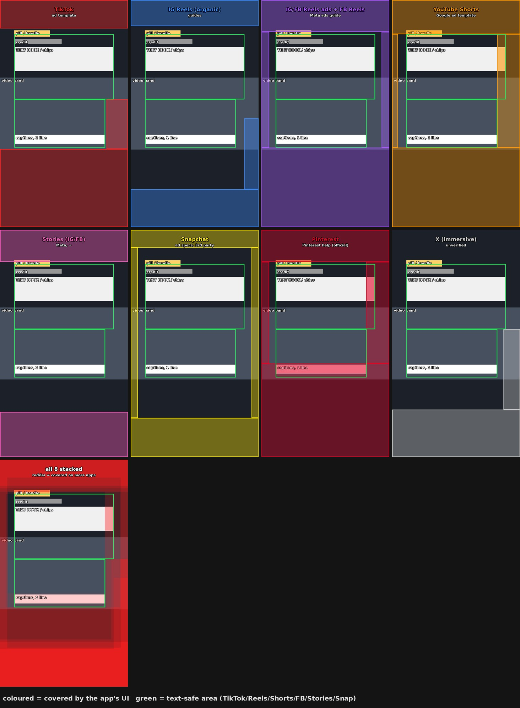

# Safe zones for vertical video

Which parts of a 1080×1920 frame the apps cover with their own UI, and where on-screen text therefore has to go.
**No platform publishes margins for organic posts:** the values below come from ad templates (ads add a button at
the bottom, so they lean conservative) or from measurements, and the UI moves with caption length, device and app
version.

| platform | top | bottom | sides | button column | source | sure? |
|---|--:|--:|--:|---|---|---|
| TikTok | 240 | 660 (username, caption, sound; long captions grow upward) | 120 | 180 px wide on the right, from y 840 | TikTok In-Feed Ads template scaled from 720×1280 ([Socialync](https://www.socialync.io/tools/safe-zones/tiktok)); the column width is measured, not published | ad template |
| Instagram Reels, organic | ~220 | ~320 | ~65 | ~120 px on the right | third-party guides ([House of Marketers](https://houseofmarketers.com/guide-to-safe-zones-tiktok-facebook-instagram-stories-reels/)) | guides |
| Instagram + Facebook Reels, ads | 14 % ≈ 269 | 35 % ≈ 672 | 6 % ≈ 65 | inside the 6 % | Meta ads guide ([Socialync](https://www.socialync.io/tools/safe-zones/facebook-reels)); Facebook's own page did not load, same numbers assumed | ad template |
| Facebook Reels, organic | — | — | — | right column | none published; every Facebook video is a Reel since 2025-06, use the ad numbers | — |
| YouTube Shorts | 288 | 672 (channel, subscribe, title) | 48 left | 192 right (the template marks it full height; in the app the buttons sit in the lower half) | [Google Ads help](https://support.google.com/google-ads/answer/9128498?hl=en): a picture, the numbers are read from it | ad template |
| Stories (Instagram/Facebook) | 14 % ≈ 270 | ~20 % ≈ 380 (reply bar; ads with a button 35 %) | ~65 | — | Meta guidance via guides | ~ |
| Snapchat (Spotlight, Snap ads) | 150 | 330 | ~60 (estimate) | Spotlight: buttons on the right, unmeasured | Snap ad specs as quoted by [Adkit](https://adkit.so/tools/safe-zones/snapchat) and [Zeely](https://zeely.ai/blog/snapchat-safe-zones-explained-for-ads/); other guides say 200 top or 35 % bottom | third party, disagree |
| Pinterest video pins | 270 | **790** | 65 left | **195 right** | [Pinterest Help](https://help.pinterest.com/en/article/review-pin-specs), the same for every video ratio | **official** |
| X (immersive viewer) | — | ~400 | — | ~140 px on the right | one vendor page ([socialk.it](https://socialk.it/en/sizes/x-video-size)) | unverified |
| LinkedIn vertical feed | — | — | ~10 % | — | nothing published; ad tools suggest ~10 % margins ([Adkit](https://adkit.so/tools/safe-zones/linkedin)) | none |

Pinterest is the only platform with official numbers for normal posts; for the rest they come from ad templates
and differ by 100–300 px between sources (Shorts, Snapchat). Treat them as minimums and look at one real post on a
phone before trusting a new platform.

## The layout that follows

**Text-safe on TikTok, Reels and Shorts** (the intersection): x 120–960; from y 840 down x 120–888 (TikTok's
buttons); y 288–1248. It also fits Facebook Reels, Stories and Snapchat. Picture may run under the UI, text may not.

A layout that fits it, for landscape footage on a vertical canvas (sharp band over a blurred fill):

| element | position |
|---|---|
| brand or series pill, end handle | top ≈ 256 |
| footage credit | top ≈ 330 |
| text hook, chips, comparison graphic | from top ≈ 398, x 120–960 |
| video band | centred (y 656–1264 for 16:9; taller when zoomed) |
| word-by-word captions | top ≈ 1140, x 120–888, ≤ 3 words per page — on the lower edge of the band |
| progress bar | none: both apps draw their own, and at the bottom it sits under TikTok's caption block |

Posting to more platforms changes the box (see the heat map):

- **Pinterest:** text above y 1130 and left of x 885, so captions move up to ≈ 950, over the upper half of the band.
- **Shorts, read literally:** hook width x 120–888 (the template's right margin covers the full height).
- **Meta ad zone, Stories, Pinterest, Shorts:** their top bars reach 269–288, so a pill at 256 is half covered;
  put anything that must be read at ≥ 290.
- Build one master for the strictest platform you actually post to, not for all ten.

Pilot lesson: a template laid out only for Instagram's 320 px bottom zone put its captions and progress bar under
TikTok's username, caption and buttons, on the platform that brought most of the reach. Check every new template
by overlaying these zones on a few rendered frames; covers have their own rules (`covers.md`).
