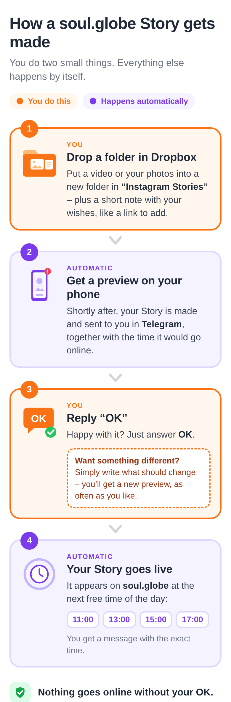
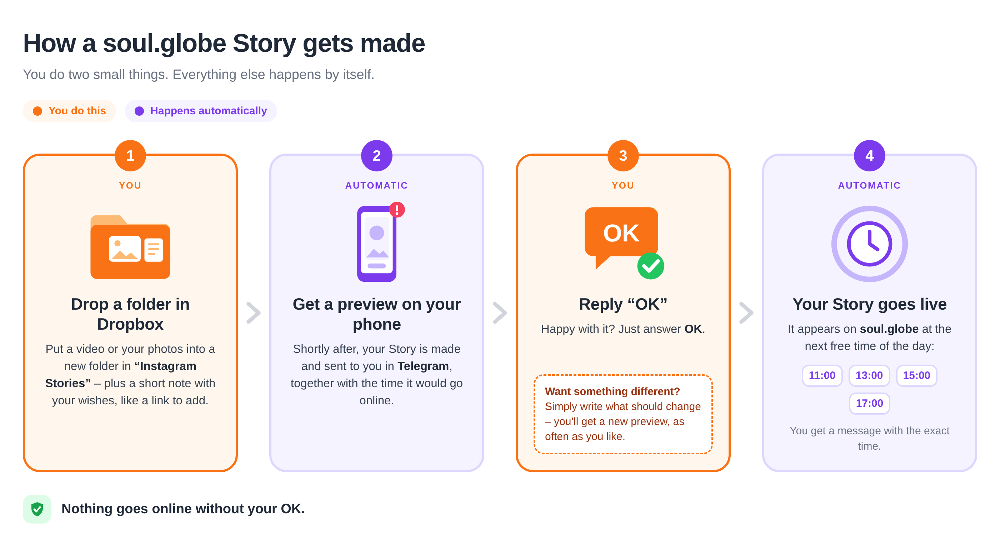
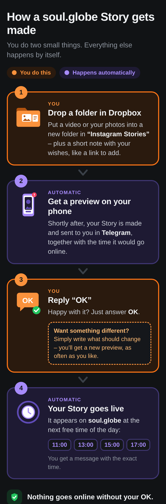
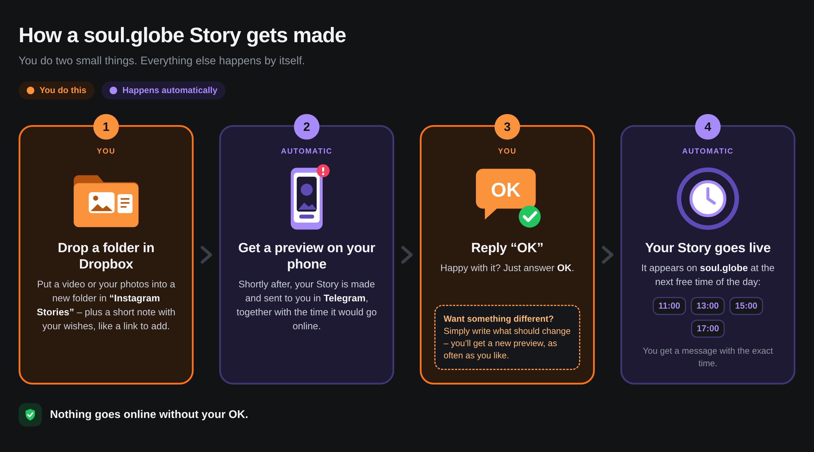
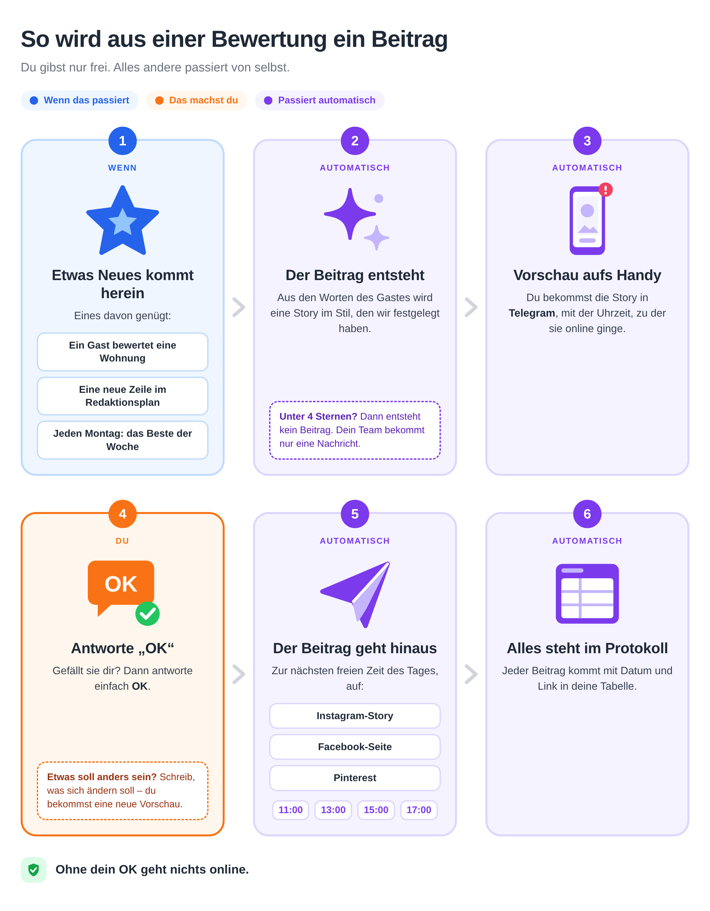

# workflow-diagram

A workflow as one page that a person who is not technical reads at a glance: what starts it, what they do, what happens by itself. A few cards in a row on a wide screen, one under the other on a phone; no lanes, no decisions, no arrows back.

It exists for [rragent](https://github.com/storrito/rragent): a bot that has agreed a job with a person shows it this way before the hook or the schedule that starts it exists, and the person says yes to the page. Without it every bot designed a diagram of its own, and the first ones were made for engineers. It is an agent of its own too ("show me how this works", see [SKILL.md](SKILL.md)).

| a phone | a wide screen |
| --- | --- |
|  |  |
|  |  |

Light or dark follows the theme of the page it is shown in, else the system's.

Six cards, something outside that starts it, several ways in and several places out, a condition as a note ([examples/review-stories.json](examples/review-stories.json)):



## The parts

- The **agent** decides the words: which steps are cards, who does each, what the person is told. It writes them as `workflow.json`.
- The **tool** builds the page and refuses what would not read at a glance (a text too long for its card, more than six cards) in a sentence that says what to do.
- The **look** is `style/`: one stylesheet and one icon per file. Neither the agent nor the tool decides any of it, so every workflow of every bot looks the same, and a change of the look is one change here.

```
node tools/diagram.mjs build <workflow.json> [--out <folder>]
node tools/diagram.mjs picture <workflow.json> [--width <px>] [--dark] [--out <file.png>]
node tools/diagram.mjs icons
```

Needs Node 20+. `picture` needs Chrome (`google-chrome` on the path, or `CHROME_PATH`). No model, no key, no npm packages.

`build` writes `index.html` beside the JSON: one file, the stylesheet and the icons inside it, nothing loaded from anywhere, and one small script, which takes the theme (below). `picture` builds and then takes a picture of the page as a screen of that width shows it (390 px, a phone, by default), light or `--dark`, for the agent to look at or for where a page cannot go.

## workflow.json

```json
{
  "lang": "en",
  "title": "How a soul.globe Story gets made",
  "subtitle": "You do two small things. Everything else happens by itself.",
  "steps": [
    {"who": "you", "icon": "folder", "title": "Drop a folder in Dropbox",
     "text": "Put a video or your photos into a new folder in **“Instagram Stories”**."},
    {"who": "auto", "icon": "phone", "title": "Get a preview on your phone",
     "text": "Shortly after, your Story is made and sent to you in **Telegram**."},
    {"who": "you", "icon": "ok", "title": "Reply “OK”",
     "text": "Happy with it? Just answer **OK**.",
     "note": {"title": "Want something different?", "text": "Write what should change – you get a new preview."}},
    {"who": "auto", "icon": "clock", "title": "Your Story goes live",
     "text": "It appears on **soul.globe** at the next free time of the day:",
     "chips": ["11:00", "13:00", "15:00", "17:00"],
     "small": "You get a message with the exact time."}
  ],
  "promise": "Nothing goes online without your OK."
}
```

| key | what | at most |
| --- | --- | --- |
| `lang` | `en` (default) or `de`: the fixed words ("You do this", "Happens automatically", …). Another language gives them as `labels` (`you`, `auto`, `event`: the word on a card; `youKey`, `autoKey`, `eventKey`: the legend) | |
| `title`, `subtitle` | the page's heading and the line under it | 60, 110 characters |
| `steps` | the cards, in order | 2 to 6 |
| `steps[].who` | `you` (the person does it), `auto` (it happens by itself), `event` (something outside starts it) | |
| `steps[].icon` | one of `icons` | |
| `steps[].title`, `.text` | the card's heading and its one or two sentences | 34, 170 |
| `steps[].items` | several things in one step: the ways it can start, the places it goes to | 5, each 40 |
| `steps[].chips` | short values side by side: times, days | 6, each 14 |
| `steps[].small` | a quiet line under them | 80 |
| `steps[].note` | `{"title", "text"}`: what else can happen at this step, as a question and a sentence | 40, 150 |
| `promise` | the line under the cards the person relies on | 90 |

`**bold**` is the only markup. The tool also names words a person may not know (`check: step 2 text says "webhook"`): a hint, not a refusal, since it may be the person's own word.

## The look

Everything about how a workflow looks is in [style/style.css](style/style.css): the colours of the three kinds of step (`--you`, `--auto`, `--event`, each with a soft tone, a background, a border and a note colour), the type, the sizes, and the three layouts by the width of the screen (one column of rows below 640 px, upright cards in two columns from there, three or four in a row on a wide screen). The custom properties at its top are what a change of the look usually touches.

**Light and dark.** The stylesheet holds every colour twice: the light values on `:root`, the dark ones for `prefers-color-scheme: dark` and for `data-theme="dark"` on the root (two blocks with the same values; keep them the same). Without anything else the page follows the system. Where a person chose a theme, [style/theme.js](style/theme.js), which the tool puts into the page, sets `data-theme` from it: from the page around this one when it is shown in a frame of the same origin (rragent's pane; rragent keeps the choice as `data-theme` on its root), else from what the browser keeps of it (`rragent.theme`), and it follows a switch there at once. In the dark values a step's main colour is the light one and its soft tone the darker, so that an icon reads on a dark card.

An icon is `style/icons/<name>.svg`, drawn on `viewBox="0 0 150 140"` with `var(--role)` for its main colour, `var(--role-soft)` for the lighter one and `var(--role-bg)` or `#fff` inside, so that it takes the colour of whichever card it sits in. A new file there is a new icon; `icons` lists them.

After a change, build the two examples and look at them at both widths:

```
node tools/diagram.mjs picture examples/story-approval.json --width 390 --out examples/story-approval-phone.png
node tools/diagram.mjs picture examples/story-approval.json --width 1400 --out examples/story-approval-wide.png
node tools/diagram.mjs picture examples/story-approval.json --width 390 --dark --out examples/story-approval-phone-dark.png
node tools/diagram.mjs picture examples/story-approval.json --width 1400 --dark --out examples/story-approval-wide-dark.png
node tools/diagram.mjs picture examples/review-stories.json --width 1100 --out examples/review-stories-wide.png
```

(`picture` writes an `index.html` beside the JSON on the way; it is not kept in the repository.)

A customer who wants a look of their own has their bot copy the skill (`skill create` in rragent) and change the copy's `style/`.

## What it does not do

A technical diagram (lanes per service, decisions, every step) has no tool here: the agent writes one by hand when the person asks for it, beside the page of the cards. The page is not interactive and shows no live state of a workflow; rragent's activity list does that.
